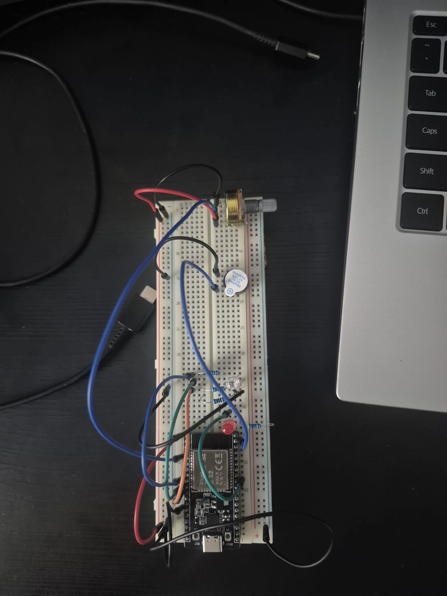

# Tema #4 - Smart Lamp Controller

## Descrierea Proiectului

Acest proiect implementează un **Controler Inteligent pentru Lampă** folosind un microcontroler ESP32. Scopul principal este crearea unei interfețe hardware robuste, controlată printr-un singur buton de tip push. Sistemul este capabil să facă distincția între apăsările scurte și cele lungi, gestionând simultan un sistem de debouncing software și temporizări asincrone pentru a asigura o execuție non-blocantă a codului.

Proiectul acoperă concepte esențiale din robotică și sisteme embedded: întreruperi hardware (ISR), mașini de stări (State Machines), debouncing prin regiștri de deplasare (Shift Registers) și controlul luminozității prin semnale PWM (Pulse Width Modulation).

## Componente Hardware și Conexiuni

Sistemul rulează pe un singur circuit fix, iar atribuirea pinilor a fost realizată conform specificațiilor laboratorului:

| Componentă | Rol în Sistem | Pin ESP32 | Mod / Configurare |
| :--- | :--- | :--- | :--- |
| **Buton Push** | Comandă sistem, schimbare stări | `GPIO 23` | `INPUT_PULLUP`, Întrerupere `FALLING` |
| **LED Extern** | Lampa principală (controlată prin PWM) | `GPIO 22` | Output PWM (Canal 0, 5000Hz, 10-bit) |
| **Built-in LED** | Indicator *Heartbeat* (rulează asincron) | `GPIO 2` | Digital Output |

*Notă: LED-ul extern necesită un rezistor de limitare a curentului adecvat pentru a preveni arderea componentei sau suprasolicitarea pinului.*

## Cerințe Implementate

Proiectul îndeplinește toate cele 4 cerințe obligatorii (checkpoints) descrise în documentație:

### 1. Moduri de Funcționare (Operating Modes)
Sistemul utilizează o structură de tip `enum` pentru a defini o mașină de stări cu 4 moduri distincte:
* **OFF ($0$):** Lampa este complet stinsă (PWM setat la $0$).
* **DIM ($1$):** Lampa este aprinsă la intensitate redusă (valoare PWM de $250$ dintr-un maxim de $4095$).
* **FULL ($2$):** Lampa luminează la capacitate maximă (valoare PWM de $4095$).
* **BLINK ($3$):** Lampa clipește intermitent la un interval de $500\text{ ms}$.

### 2. Operații Independente (Independent Operations)
Pentru a evita blocarea microcontrolerului, codul renunță complet la funcția `delay()`. Toate temporizările sunt realizate folosind `millis()`:
* **Heartbeat-ul sistemului:** LED-ul integrat (`GPIO 2`) clipește de două ori, urmat de o pauză de $1000\text{ ms}$, demonstrând că bucla principală rulează continuu și fără întreruperi.
* **Blink-ul lămpii:** Alternarea stării lămpii în modul `BLINK` este gestionată tot prin diferențe de timp asincrone.

### 3. Gestionarea Apăsărilor Scurte și Lungi (Short and Long Presses)
* **Apăsare Scurtă:** La fiecare apăsare scurtă validată, lampa trece ciclic prin modurile definite: `OFF` $\rightarrow$ `DIM` $\rightarrow$ `FULL` $\rightarrow$ `BLINK` $\rightarrow$ `OFF`.
* **Apăsare Lungă:** Dacă butonul este menținut apăsat pentru o durată de cel puțin $1000\text{ ms}$ (definită prin `holdTargetDuration`), lampa trece automat în modul `OFF`, indiferent de starea anterioară.

### 4. Tratarea Butonului folosind Întreruperi (Interrupt-Assisted Button Handling)
Pentru a optimiza consumul de resurse, starea butonului nu este citită constant (polling continuu).
* Am atașat o întrerupere pe front descendent (`FALLING`) pe pinul butonului. Când butonul este apăsat (semnalul trece din `HIGH` în `LOW`), se apelează rutina de tratare a întreruperii (ISR - `buttonInt`), care doar setează un *flag* (`checkButton = true`).
* În bucla principală, detectarea flag-ului declanșează procesul de validare (Debouncing).
* **Debouncing simetric pe 8 biți:** Validarea se face printr-un registru de deplasare (`uint8_t history = 0xFF`), eșantionat la fiecare $5\text{ ms}$. O apăsare este validată doar când variabila devine `0x00` (8 citiri consecutive de `LOW`), iar o eliberare este recunoscută doar când revine la `0xFF` (8 citiri consecutive de `HIGH`). Astfel, filtrarea contactelor imperfecte este impecabilă.

## Materiale Suplimentare

### Schemă Circuit

### Demonstrație Video
În videoclipul de mai jos este prezentat circuitul asamblat, demonstrând toate modurile lămpii, modul în care Heartbeat-ul continuă netulburat, precum și comportamentul distinct la apăsarea scurtă față de cea lungă.

[**Urmăriți Demonstrația Video pe YouTube**](https://youtu.be/_oXuvhJiMrE?is=L0dtnDDYudmZvkVq)