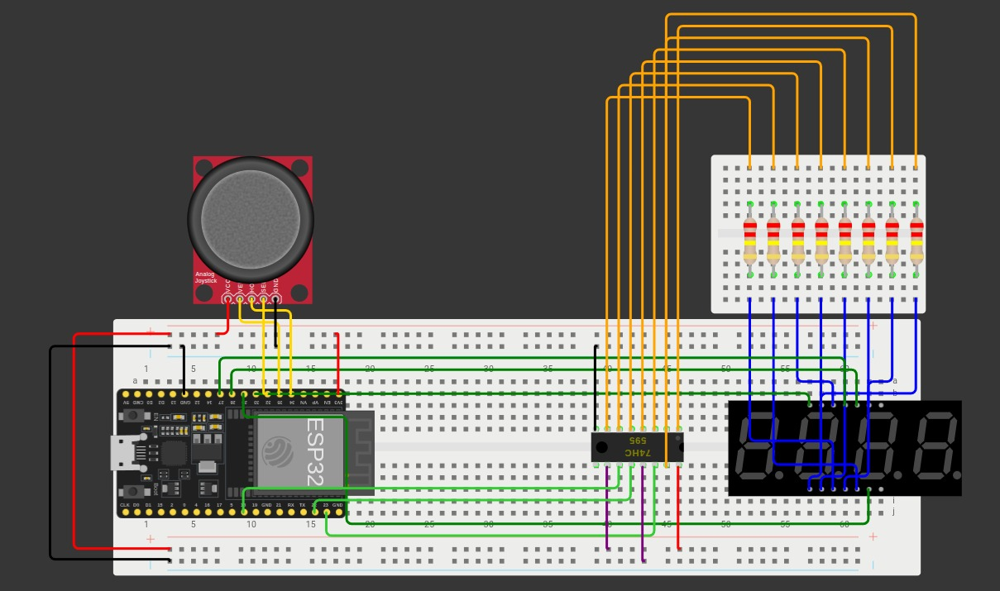
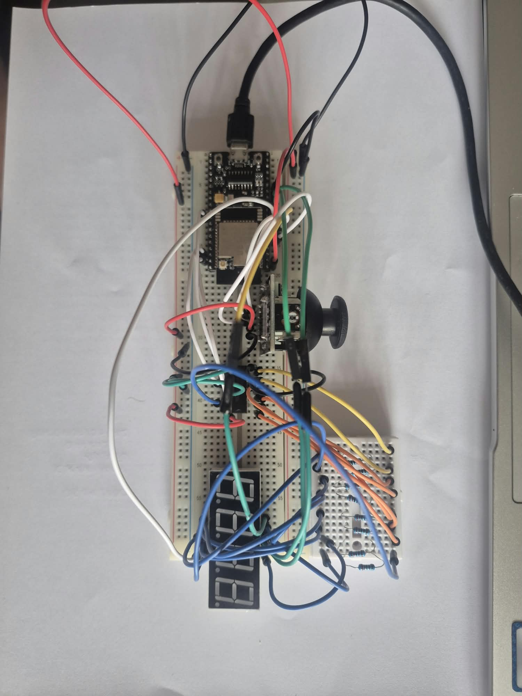

# Tema #5 - Stop the Counter!

## Descrierea Proiectului

Acest proiect implementază un joc interactiv de reacție **"Stop the Counter!"** folosind un microcontroler ESP32, un registru de deplasare 74HC595, un afișaj cu șapte segmente și 4 cifre și un joystick analoog cu buton. Scopul jucătorului este de a opri un contor descrescător cât mai aproape posibil de un număr țintă afișat pe ecran.

Proiectul integrează concepte esențiale din sisteme embedded: operare non-blocantă bazată pe timp (`esp_timer`), mașini de stări finite (State Machines), controlul biților prin operatori pe biți pentru afișajul multiplexat și prelucrarea semnalelor de la joystick cu zone de „dead zone” și debouncing.

## Componente Hardware și Conexiuni

Sistemul utilizează un circuit fix, iar atribuirea pinilor respectă specificațiile din laborator:

| Componentă | Rol în Sistem | Pin ESP32 | Mod / Configurare |
| :--- | :--- | :--- | :--- |
| **74HC595 Data (DS)** | Transmitere date seriale (segmente) | `GPIO 23` | Digital Output |
| **74HC595 Shift Clock (SHCP)** | Ceas pentru deplasarea biților | `GPIO 18` | Digital Output |
| **74HC595 Latch (STCP)** | Latch pentru afișare | `GPIO 22` | Digital Output |
| **Selecție Cifre (D1–D4)** | Multiplexare catod cifre display | `GPIO 25, 26, 27, 33` | Digital Output |
| **Joystick X-axis (VRx)** | Citire poziție orizontală / navigare | `GPIO 34` | ADC Channel 6 |
| **Joystick Y-axis (VRy)** | Citire poziție verticală / pornire/reset | `GPIO 35` | ADC Channel 7 |
| **Joystick Button (SW)** | Oprire contor (Stop) | `GPIO 32` | Input / Buton cu Pull-up |

*Notă: Registrul 74HC595 și joystick-ul sunt alimentate la $3.3\text{V}$, iar segmentele display-ului utilizează rezistoare de limitare a curentului de $1\text{220}\Omega$.*

## Cerințe Implementate

Proiectul îndeplinește toate cerințele din specificația temei:

### 1. Număr Țintă și Stare Inițială
La pornire (`START`), sistemul generează și afișează un număr țintă aleatoriu cuprins între $4000$ și $8000$ (folosind funcția hardware `esp_random()`). Jucătorul poate vizualiza clar valoarea țintă înainte de a începe runda.

### 2. Pornirea Cronometrului (Countdown)
Prin acționarea joystick-ului în sus, jocul trece în starea `PLAYING`. Un contor pornește de la valoarea maximă de $9999$ și scade treptat spre țintă. Viteza de scădere este calibrată asincron (aproximativ $1\text{ ms}$ per unitate), oferind o durată totală de aproximativ $5\text{ secunde`, perfect încadrată în intervalul jucabil de 3–10 secunde. Dacă jucătorul nu intervine, contorul se oprește automat la zero.

### 3. Oprirea și Calculul Scorului
Jucătorul apasă butonul joystick-ului pentru a opri cronometrul. În acel moment:
- Afișajul se blochează instantaneu pe valoarea curentă (`STOPPED VALUE`).
- Se calculează eroarea absolută: $\text{Error} = |\text{Valoare Oprită} - \text{Țintă}|$.
- Rezultatul detaliat (Țintă, Valoare Oprită și Eroare) este transmis și afișat în Serial Monitor prin `ESP_LOGI`.

### 4. Resetare și Reluare (Replay)
Tragerea joystick-ului în jos în starea finală (`END`) resetează jocul, generând un nou număr țintă și pregătind runda următoare în mod intuitiv, fără a necesita repornirea microcontrolerului.

### 5. Suprimarea Zerourilor din Față
Afișajul elimină automat zerourile nesemnificative (de exemplu, `0042` devine `  42`), asigurând lizibilitatea corectă, în timp ce valoarea `0` rămâne vizibilă sub forma unei singure cifre.

### 6. Controlul Bazat pe Biți (Bitwise Display Control)
Toată logica de codificare a segmentelor și multiplexarea cifrelor utilizează operații pe biți și măști compacte pe tipuri de date `uint8_t`, fără a recurge la librării externe prefabricate pentru afișaj.

### 7. Implementare Non-Blocantă
Codul folosește exclusiv temporizări asincrone bazate pe `esp_timer_get_time()`, evitând complet buclele de tip `delay()` sau busy-waiting. Display-ul rămâne în permanență actualizat prin intermediul unui timer periodic dedicat (`esp_timer`).

## Materiale Suplimentare

### Schemă Circuit și Montaj

### Demonstrație Video
În videoclipul de mai jos este prezentat circuitul complet și o rundă demonstrativă de joc (pornire, numărătoare, oprire cu calculul erorii și resetare).

[**Urmăriți Demonstrația Video pe YouTube**](https://www.youtube.com/watch?v=A7RAHS90SE0)