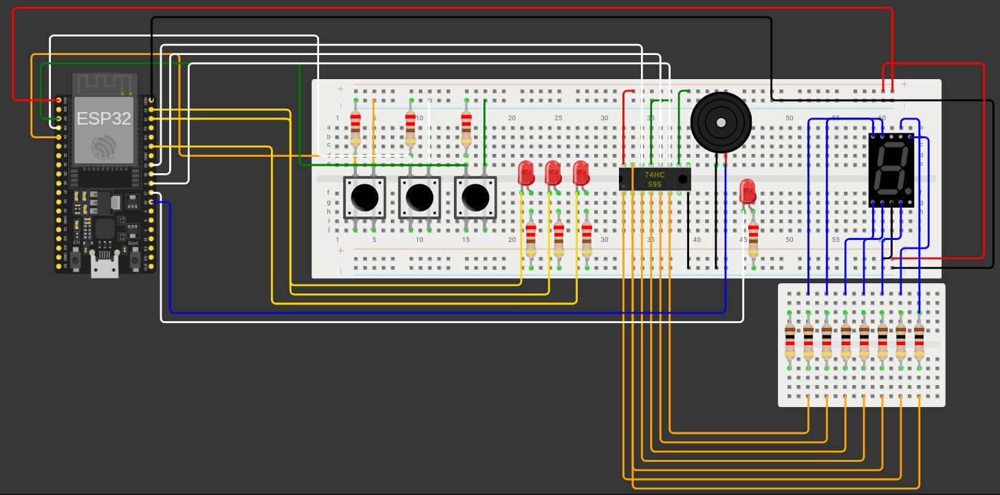
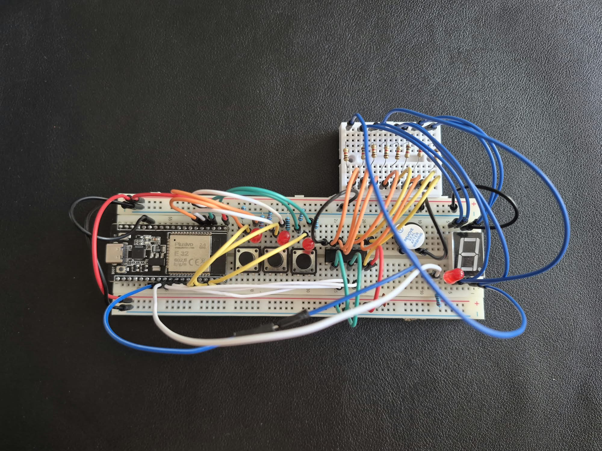

# Tema #6 - Three-Floor Elevator Controller

## Descrierea Proiectului

Acest proiect implementează un sistem de control pentru un **lift cu trei etaje** folosind microcontrolerul ESP32 și framework-ul nativ ESP-IDF. Sistemul răspunde la comenzile fizice de la butoanele de etaj, simulează închiderea și deschiderea ușilor, precum și deplasarea progresivă între etaje, oferind feedback vizual (afișaj cu 7 segmente și LED-uri de stare) și auditiv (buzzer pasiv controlat prin PWM).

Arhitectura este bazată pe evenimente și combină o mașină de stări finite (FSM), timere hardware de înaltă rezoluție (`esp_timer`), sincronizare lock-free între task-uri și nuclee prin variabile atomice (`std::atomic<bool>`), precum și controlul afișajului printr-un registru de deplasare 74HC595.

---

## Componente Hardware și Conexiuni

Circuitul este realizat pe un montaj fix, respectând nivelul logic de 3.3V al ESP32:

| Componentă | Rol în Sistem | Pin ESP32 | Mod / Configurare |
| :--- | :--- | :--- | :--- |
| **Buton Etaj 1** | Cerere deplasare la Etajul 1 | `GPIO 34` | Input-only (necesită pull-up extern) |
| **Buton Etaj 2** | Cerere deplasare la Etajul 2 | `GPIO 39` | Input-only (necesită pull-up extern) |
| **Buton Etaj 3** | Cerere deplasare la Etajul 3 | `GPIO 36` | Input-only (necesită pull-up extern) |
| **LED Cerere Etaj 1** | Indicator cerere activă Etaj 1 | `GPIO 21` | Digital Output |
| **LED Cerere Etaj 2** | Indicator cerere activă Etaj 2 | `GPIO 22` | Digital Output |
| **LED Cerere Etaj 3** | Indicator cerere activă Etaj 3 | `GPIO 23` | Digital Output |
| **LED Mișcare Lift** | Indicator deplasare (clipește în mișcare) | `GPIO 17` | Digital Output |
| **Buzzer Pasiv** | Notificări audio uși / sosire | `GPIO 16` | LEDC PWM (`LEDC_TIMER_0`, `CHANNEL_0`) |
| **74HC595 Data (DS)** | Date seriale pentru afișaj 7 segmente | `GPIO 19` | Digital Output |
| **74HC595 Latch (STCP)** | Latch actualizare afișaj | `GPIO 5` | Digital Output |
| **74HC595 Shift Clock (SHCP)** | Ceas deplasare biți | `GPIO 18` | Digital Output |

*Notă hardware: Pentru segmentele afișajului cu 7 segmente s-au utilizat rezistoare de limitare a curentului de **1000 Ω**, iar pentru LED-urile de stare (indicatoarele de etaj și LED-ul de mișcare) s-au folosit rezistoare de **220 Ω**. Pinii `GPIO 34`, `GPIO 36` și `GPIO 39` sunt pini exclusiv de intrare pe ESP32 și nu dispun de rezistoare interne de pull-up, motiv pentru care sunt conectați cu rezistoare externe de pull-up la 3.3V.*

---

## Cerințe și Funcționalități Implementate

### 1. Stare Inițială și Afișarea Etajului Curent
La pornire, liftul este inițializat la primul etaj (indexat intern `0`, corespunzător Etajului 1) în starea `IDLE`, iar afișajul cu 7 segmente indică etajul curent prin intermediul clasei `ShiftRegister`. Pe parcursul deplasării, afișajul se actualizează progresiv la trecerea prin fiecare etaj intermediar, fără a sări direct la destinație.

### 2. Citirea Butoanelor și Debouncing Software
Citirea celor trei butoane se realizează asincron printr-un timer periodic (`inputTimerHandle`) configurat la un interval de **$3\text{ ms}$**. Fiecare buton utilizează un registru de deplasare pe 8 biți (`history`) pentru filtrarea zgomotului mecanic (debouncing) și detecția frontului (`0x00` la apăsare, `0xFF` la eliberare), prevenind înregistrarea multiplă la o singură apăsare sau la menținerea butonului apăsat. Cererile duplicat pentru un etaj deja activ în coadă sunt ignorate automat.

### 3. Mașina de Stări a Liftului (FSM)
Logica principală este structurată într-o mașină de stări finite cu 4 stări:
- **`IDLE`**: Liftul staționează cu ușile închise și verifică coada de cereri prin `findNextFloor()`. Dacă există o cerere la alt etaj, inițiază închiderea ușilor (`CLOSING_DOORS`); dacă se apasă butonul etajului curent, redeschide ușile (`OPENING_DOORS`).
- **`CLOSING_DOORS`**: Simulează închiderea ușilor timp de **$2\text{ secunde}$** cu semnal sonor dedicat, apoi reverifică coada de cereri înainte de a porni spre destinație (`MOVING`) sau de a reveni în `IDLE`.
- **`MOVING`**: Deplasează liftul etaj cu etaj (câte **$1\text{ secundă}$** per etaj), actualizând afișajul la fiecare nivel și verificând la fiecare pas dacă etajul curent are o cerere activă în coadă.
- **`OPENING_DOORS`**: Elimină cererea etajului deservit din coadă, stinge LED-ul aferent și simulează deschiderea ușilor timp de **$2\text{ secunde}$** cu semnal sonor de sosire, trecând apoi în `CLOSING_DOORS`.

### 4. Indicatoare LED pentru Cereri și Mișcare
- **LED-urile de etaj (`GPIO 21, 22, 23`)**: Se aprind instantaneu la înregistrarea unei cereri în timer-ul de input și rămân aprinse până când liftul ajunge la etajul respectiv și deschide ușile.
- **LED-ul de mișcare (`GPIO 17`)**: Este controlat independent printr-un timer periodic dedicat de **$300\text{ ms}$** (`blinkTimerArgs`). Clipește exclusiv cât timp flag-ul atomic `isMoving` este `true` și rămâne stins când liftul este oprit.

### 5. Notificări Audio prin LEDC PWM
Buzzer-ul pasiv este pilotat de perifericul hardware LEDC (rezoluție pe 10 biți) pentru a genera două tonuri distincte:
- **Închidere uși**: Notă gravă (`Sol4` — **$392\text{ Hz}$**, duty cycle `128`) pentru un semnal discret de avertizare.
- **Deschidere uși / Sosire**: Notă înaltă (`Do6` — **$1047\text{ Hz}$**, duty cycle `512`) pentru un semnal clar de confirmare.

### 6. Coada de Cereri și Planificare Inteligentă (Bonus)
Cererile primite în timp ce liftul este ocupat sunt memorate într-un vector de flag-uri atomice (`inQueue`), prevenind dublarea opririlor pentru același etaj. Funcția `findNextFloor()` implementează un algoritm de planificare de tip **SCAN (algoritmul liftului)**: liftul își continuă deplasarea în direcția curentă (`direction = 1` pentru urcare, `-1` pentru coborâre) pentru a deservi toate cererile aflate în drum înainte de a inversa sensul.

### 7. Sincronizare Lock-Free și Operare Responsivă
Citirea butoanelor și controlul clipirii LED-ului rulează asincron în task-ul `esp_timer`, complet independent de temporizările din bucla principală, permițând înregistrarea comenzilor în orice stare a liftului. Partajarea datelor între `esp_timer` și task-ul principal `app_main` (care pot rula pe nuclee diferite ale ESP32) este realizată **lock-free** folosind variabile `std::atomic<bool>` (`inQueue`, `isMoving`, `ledState`), garantând vizibilitatea imediată în memoria RAM și eliminând necesitatea unui mutex.

### 8. Diagnosticare prin ESP-IDF Logging
Evenimentele importante (inițializarea, recepționarea comenzilor, destinația, direcția de deplasare, trecerea prin etaje și tranzițiile de stare) sunt raportate în Serial Monitor prin `ESP_LOGI` sub tag-ul `"ELEVATOR"`.

---

## Funcționalități Bonus Implementate

- **Shift Register 74HC595**: Utilizat pentru comanda afișajului cu 7 segmente prin doar 3 pini GPIO (`DS`, `LATCH`, `CLOCK`), încapsulat în clasa `ShiftRegister`.
- **Planificare inteligentă a etajelor (SCAN)**: Deservirea cererilor pe traseu în funcție de direcția curentă de deplasare, înainte de schimbarea sensului.
- **Efecte sonore diferențiate**: Frecvențe și niveluri de intensitate (duty cycle) distincte pentru închiderea și deschiderea ușilor generate hardware prin LEDC.
- **Arhitectură Lock-Free Multi-Core**: Sincronizare sigură între timerele `esp_timer` și mașina de stări folosind `std::atomic<bool>`, fără blocaje pe semafoare.

---

## Materiale Suplimentare

### Schemă Circuit și Montaj

### Demonstrație Video
În videoclipul de mai jos este prezentat circuitul asamblat și funcționarea completă a liftului (pornire la etajul 1, cereri multiple în timpul deplasării, semnale sonore și actualizarea afișajului):

[**Urmăriți Demonstrația Video pe YouTube**](https://www.youtube.com/watch?v=A7RAHS90SE0)